  <picture>
    <source media="(prefers-color-scheme: dark)" srcset="assets/readme/banner-dark.svg">
    
  </picture>

<h1 align="center">popcornpals</h1>

Watch the same video at the same moment with up to 4 friends, with chat, voice and cameras. Peer to peer, no account.

  <a href="https://kwy404.github.io/popcornpals/app/"><b>Open the app</b></a> &middot;
  <a href="https://kwy404.github.io/popcornpals/">Website</a> &middot;
  <a href="https://kwy404.github.io/popcornpals/#extension">The extension</a> &middot;
  <a href="i18n/README.pt-BR.md">Português</a>

popcornpals is a watch party that runs entirely in the browser. You start a room, share six words with your friends, and press play: play, pause, seek and speed stay in step on every screen. Video, voice and chat go straight between the browsers over WebRTC. There is no server of ours in the middle and nothing to sign up for.

## Quick start

1. Open **[kwy404.github.io/popcornpals/app](https://kwy404.github.io/popcornpals/app/)**, type your name and press **Start a room**.
2. Press **Invite friends**. Your friend can type the six words, scan the QR code or open the invite link. All three carry the same words.
3. Your friend reads six confirmation words back to you. Type them and the door opens.
4. Pick something to watch.

  <picture>
    <source media="(prefers-color-scheme: dark)" srcset="assets/readme/six-words-dark.svg">
    
  </picture>

## What you can watch

- **Your own video file.** The host picks one local file and it streams from the host's device to every guest. Guests pick nothing. Picture quality depends on the host's upload speed, shared by every guest, and popcornpals shows the quality it reaches.
- **Best quality mode.** When everyone already has the same file, each person opens their own copy. A quick fingerprint checks that the files match, and only sync messages travel.
- **Subtitles.** Load an .srt or .vtt file and everyone sees them.
- **YouTube videos.** Paste a link. Everyone loads the official embedded player and play, pause, seek and speed stay in sync.
- **Screen share.** Share a tab, a window or the whole screen, with its sound where the browser can capture it.
- **Streaming sites, with the optional extension.** It plays, pauses and seeks each person's own player on the site, signed in to their own account. It never captures, records or re-streams video and never touches copy protection.

  <picture>
    <source media="(prefers-color-scheme: dark)" srcset="assets/readme/in-sync-dark.svg">
    
  </picture>
  <picture>
    <source media="(prefers-color-scheme: dark)" srcset="assets/readme/screening-room-dark.svg">
    
  </picture>

## Together in the room

- **Text chat** with replies, reactions, and times like 1:24:07 that take everyone to that moment.
- **Voice** for everyone, with mute and a light ducking that lowers the movie while someone talks.
- **Noise suppression**: the browser's own, plus a Strong mode that runs our DSP in an AudioWorklet (high and low pass, spectral suppression and a voice gate, about 11 ms of added delay).
- **Cameras** shown as small seats under the screen, which go away when turned off.
- **Device pickers** for the microphone, the camera and the speakers, in Settings.
- **A context menu** on the player, the people and the messages, by right click, long press, Shift+F10 or the Menu key: sync everyone to you, copy the time, speed, picture in picture, fullscreen, a person's volume or mute on your device only, hand the host role over, and copy, reply or react to a message.
- **Reactions** that float over the picture, a shared queue, a host lock for the controls, English and Portuguese, light and dark themes, and an installable app.

## The extension

The extension is optional and only needed for streaming sites. Download the zip from the [website](https://kwy404.github.io/popcornpals/#extension), unzip it, turn on developer mode on your browser's extensions page and choose **Load unpacked**. The website shows each step and the SHA-256 of the zip. It works on Chromium based browsers. It is not in any store.

## Privacy and limits

  <picture>
    <source media="(prefers-color-scheme: dark)" srcset="assets/readme/black-screen-dark.svg">
    
  </picture>

- No server of ours sees your video, voice or messages. The website and the app are static files.
- WebRTC encrypts every connection with DTLS. The six words meet on public MQTT relays, encrypted with a key made from the words, so the relays only see ciphertext. In an invite link the words sit after the `#`, a part browsers never send to any server.
- Each invite works once, for 10 minutes, and the host always types the confirmation words, so leaked words alone are not enough.
- Up to 5 people per room, all online at the same time.
- Many streaming services block screen capture of protected video, so a shared screen shows black. Sharing never replaces a subscription.
- The browser must be able to play the host's file. Some formats, such as some MKV files, do not play in every browser.
- Some YouTube videos do not allow embedding, and each person sees their own ads. Inside the YouTube player its own right click menu shows; the popcornpals menu opens from the controls bar under it.
- Choosing the speakers needs a browser that supports it; elsewhere sound plays on the system default output.
- When both sides are behind strict networks, a direct connection can fail. Add your own TURN server in Settings.

## Development

| Command | What it does |
| --- | --- |
| `npm test` | Unit tests (Vitest) |
| `npm run lint` | ESLint |
| `npm run rules` | House rules for every text file |
| `npm run links` | Checks every local link and image |
| `npm run core` | Copies the shared modules from `src/` to `docs/app/core/` |
| `npm run e2e` | A real watch party in four headless browsers with fake devices |
| `npm run e2e:ext` | The extension, loaded unpacked, on a test streaming page |
| `npm run e2e:yt` | YouTube sync in two browsers (needs the network) |
| `npm run readme:art` | Builds the animated README art from the approved drawings |
| `npm run serve` | Serves `docs/` at http://127.0.0.1:8080/ |

The website is built with [Monsoon](https://kwy404.github.io/monsoon/) and its interactive parts with [Voodoo.js](https://kwy404.github.io/Voodoo.js/). See [CONTRIBUTING.md](CONTRIBUTING.md) and [SECURITY.md](SECURITY.md).

## Author

Made by **Alexandre Kohler** ([GitHub](https://github.com/kwy404), [LinkedIn](https://www.linkedin.com/in/alexandre-silva-173687256/)). More from kwy404: [Monsoon](https://kwy404.github.io/monsoon/), [Voodoo.js](https://kwy404.github.io/Voodoo.js/), [filefinch](https://kwy404.github.io/filefinch/), [howlden](https://kwy404.github.io/howlden/) and others on [GitHub](https://github.com/kwy404).

## License

[MIT](LICENSE) 2026 Alexandre Kohler
